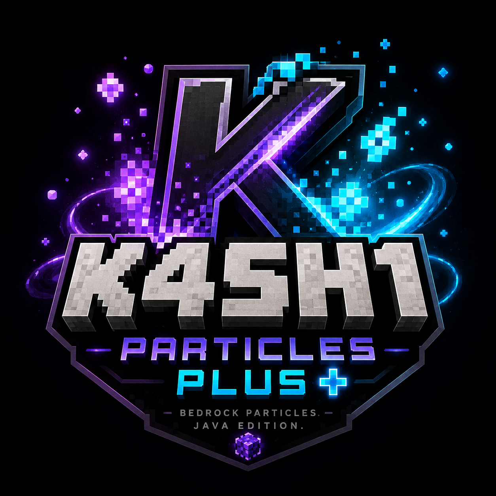

  

# KASHI Particles Plus

An [MCreator](https://mcreator.net/) plugin that imports Bedrock/Snowstorm `.particle.json` particle
effects into a mod, plays them with full fidelity, and fires them from Blockly procedure blocks —
no GeckoLib, no hand-written Java, no reduced feature set.

Snowstorm is Mojang's own particle authoring tool for Bedrock Edition
([snowstorm.app](https://snowstorm.app/)). This plugin adds a "KASHI Particle" mod element that
takes what you exported from it — the JSON plus its texture — and plays that exact effect in a
Java/NeoForge mod. The procedure blocks only *fire* the effect; every detail of duration, motion,
shape, colour, animation and events comes from the imported file, evaluated by KASHI's own MoLang
engine.

## Status

**v2.5.0** — production-ready. Targets **MCreator 2026.1.x**, with either the **NeoForge 1.21.1**
or **NeoForge 1.21.8** generator (see [docs/ROADMAP.md](docs/ROADMAP.md) for what's next).

## Features

- Imports a `.particle.json` + its PNG texture through a wizard page on the mod element, validated
  against the same parser the runtime uses, so a broken file is caught at import time with the
  offending component named — not as a crash when the mod loads in-game.
- Full component coverage for the Bedrock particle spec: emitter shapes (point, disc, sphere,
  box, entity AABB, custom), emitter lifetime (once, looping, expression-driven), spawn rate
  (steady, instant, manual), dynamic and parametric particle motion, collision, kill planes,
  curves (linear, catmull_rom, bezier, bezier_chain), local space (follow the entity that fired
  it), events (`particle_effect`, `sound_effect`, `expression`, `sequence`, `randomize`, `log`),
  flipbook animation, and colour gradients/expressions.
- Three procedure blocks: spawn at a world position, spawn from an entity's feet (with a
  local-frame offset and an aim mode), and spawn from a block. Aim mode controls how much of the
  firing entity's look direction the effect inherits. Every block also takes optional additive
  `scale` and `duration` offsets on top of what the effect authored — `0` (the default) always
  leaves Snowstorm as the source of truth.
- Reliable at range and in multiplayer: a fired effect broadcasts to every player within 512
  blocks, not just the one who fired it.
- A self-contained MoLang expression compiler and evaluator (`core/`) — no GeckoLib dependency,
  parses once per expression and re-evaluates the compiled form every tick/frame.
- Wizard-time diagnostics: catches effects that would draw nothing (zero size, zero alpha, a
  flipbook that outruns its own sheet), effects that reference other effects that were not
  imported, and effects likely to spawn a very large number of particles.
- A `/kashiparticle_<modid>` debug command (client-only) to fire an effect without wiring a
  procedure, and to report what every fired effect actually did — spawned, drawn, at what size and
  alpha — because "nothing appeared" can mean four different things that all look identical from
  the outside.

## Requirements

- MCreator 2026.1.x, with the **NeoForge 1.21.1** or **NeoForge 1.21.8** generator.
- Java plugins enabled in MCreator's preferences (MCreator → Preferences → enable Java plugin
  support, if not already on).

## Installation

1. Download `kashi_particles_plus.zip` from [Releases](../../releases).
2. Drop it into your MCreator plugins folder (`.mcreator/plugins/` under your user profile).
3. Restart MCreator.
4. In a NeoForge 1.21.1 or 1.21.8 workspace, **Mod element → New mod element → KASHI Particle**
   should now be available.

## Usage

1. Export an effect from [Snowstorm](https://snowstorm.app/) as a `.particle.json`, with its
   texture as a separate PNG.
2. Create a new **KASHI Particle** mod element, click **Import .particle.json…**, and pick the
   texture.
3. If the effect references other effects through its events (a hit effect that also plays a
   sound-trail effect, for instance), import those too — an effect that isn't imported simply
   doesn't play when referenced, silently.
4. Use one of the three **KASHI Particles** procedure blocks to fire it:
   - **Spawn KASHI Particle at x/y/z** — world position, authored orientation. Best for area
     effects.
   - **Spawn KASHI Particle from entity** — from the entity's feet, with a local-frame offset
     (`forward`/`right`/`up`) and an **aim** mode (full look, yaw-only, or none).
   - **Spawn KASHI Particle from block** — at the centre of a block.

See [docs/USAGE.md](docs/USAGE.md) for the full block reference, aim-mode semantics, and
performance guidance for firing many effects at once.

## Documentation

- [docs/USAGE.md](docs/USAGE.md) — importing effects, the procedure blocks, aim modes, the debug
  command, and performance guidance for firing many effects at once.
- [docs/DEVELOPMENT.md](docs/DEVELOPMENT.md) — building from source. This is **not** the standard
  MCreator Gradle plugin workflow — see why, plus the full build pipeline (`tools/*.ps1`/`*.py`),
  prerequisites, and how the local dev environment is laid out.
- [docs/ARCHITECTURE.md](docs/ARCHITECTURE.md) — how it works internally: the MoLang engine, the
  particle lifecycle, the code-generation pipeline, and the non-obvious decisions worth
  understanding before changing anything.
- [docs/ROADMAP.md](docs/ROADMAP.md) — what's done (including the historical Bedrock parity plan
  this plugin was built against) and what's next.
- [docs/CLAUDE.md](docs/CLAUDE.md) — a short orientation file for an AI assistant (or new
  contributor) opening this repository, pointing into the docs above.

## License

[MIT](LICENSE) — see the LICENSE file.
